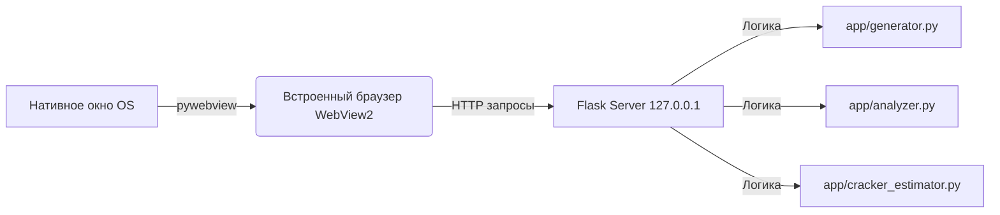

# 🔐 Password Forge

**Password Forge** — это современное десктопное приложение для генерации и криптографического анализа надёжности паролей. Всё работает локально: ваши пароли никогда не покидают ваше устройство.

---

## ✨ Возможности приложения

| Функция | Описание |
|---------|----------|
| 🎲 4 метода генерации | Классический, парольная фраза (passphrase), произносимый и по пользовательскому шаблону |
| 📊 Анализ энтропии | Мгновенный расчёт битов энтропии и визуальная шкала надёжности |
| ⏱ Оценка времени взлома | Моделирование атак (офлайн-хеш, онлайн-угадывание) с понятным отображением времени |
| ⚠️ Умные предупреждения | Выявление паттернов клавиатуры, словарных слов и повторяющихся символов |
| 🛡 100% Локальность | Никаких внешних API. Генерация и анализ происходят исключительно на вашем ПК |

---

## 📋 Системные требования

### Обязательные компоненты

Перед запуском убедитесь, что в системе установлены:

- **Python 3.8** или выше  
  [Скачать с python.org](https://www.python.org/downloads/)

- **🚨 Microsoft Edge WebView2 Runtime** (Критически важно для Windows!)  
  Без этого компонента графический интерфейс не сможет открыться.  
  [Скачать WebView2 Runtime (Evergreen Installer)](https://developer.microsoft.com/ru-ru/microsoft-edge/webview2/)

---

## 📦 Установка и настройка

Выполните следующие шаги в терминале (командной строке):

### 1. Перейдите в папку с проектом
```bash
cd C:\Users\waster\PycharmProjects\Pass_Gen_Project
```

### 2. Активируйте виртуальное окружение

**Для Windows:**
```bash
.venv\Scripts\activate
```

**Для macOS/Linux:**
```bash
source .venv/bin/activate
```

### 3.  Установите зависимости
```bash
pip install -r requirements.txt
```

---

## 🚀 Запуск приложения

После установки всех зависимостей запустите:

```bash
python main.py
```

---

## ⚙️ Архитектура приложения

Ниже представлена схема взаимодействия компонентов системы:



---

<p align="center">Создано с ❤️ для безопасного цифрового мира</p>